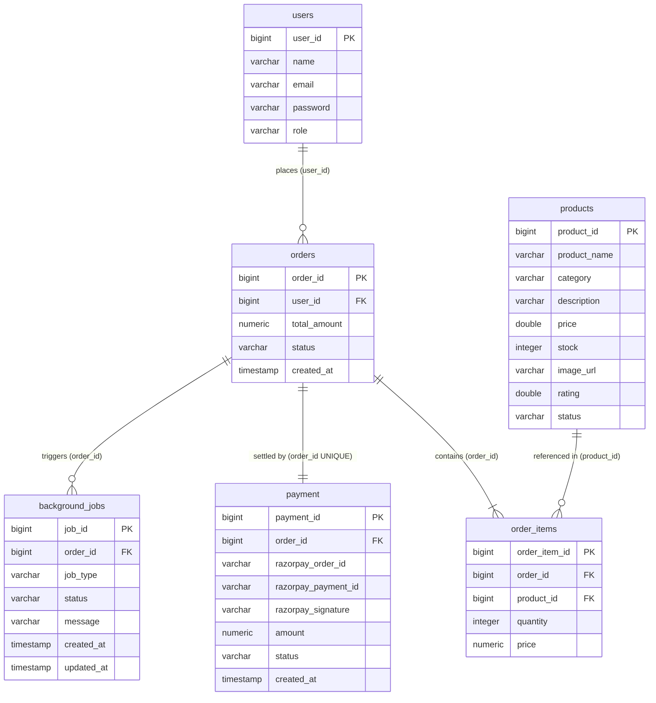

# SmartCart Database Documentation

Relational persistence schema stored in **PostgreSQL 18** under database **`ecommerce_db`** and managed automatically by Hibernate JPA (`spring.jpa.hibernate.ddl-auto=update`).

> **Note:** An earlier legacy test database named `ecommerce` was removed. The active database for SmartCart is **`ecommerce_db`**.

---

## 1. Connection & Engine Configuration

| Setting | Value (`application.properties`) | Notes |
| :--- | :--- | :--- |
| **DBMS** | PostgreSQL (`postgresql-x64-18`) | Running on port `5432` |
| **Database Name** | `ecommerce_db` | Overridable via `DATABASE_URL` env var |
| **JDBC URL** | `jdbc:postgresql://localhost:5432/ecommerce_db` | Configured in `spring.datasource.url` |
| **Username / Password** | `postgres` / `root` | Local dev credentials |
| **DDL Strategy** | `update` (`spring.jpa.hibernate.ddl-auto=update`) | Automatically creates/alters tables on startup |

---

## 2. Entity-Relationship Diagram



---

## 3. Table Specifications

All primary keys use `GenerationType.IDENTITY` (`BIGINT GENERATED BY DEFAULT AS IDENTITY` in PostgreSQL).

### 3.1 `users` (`User.java`)

Stores customer and administrator credentials.

| Column | Type / Mapping | Constraints | Notes |
| :--- | :--- | :--- | :--- |
| `user_id` | `BIGINT` (`Long`) | `PK`, `IDENTITY` | Auto-generated user ID |
| `name` | `VARCHAR` (`String`) | — | Full display name |
| `email` | `VARCHAR` (`String`) | Uniqueness enforced in `UserService.signup` | Login identifier (`existsByEmail`) |
| `password` | `VARCHAR` (`String`) | `@JsonProperty(WRITE_ONLY)` | BCrypt hashed password |
| `role` | `VARCHAR` (`Role` enum) | `@Enumerated(STRING)` | `USER` or `ADMIN` |

> **Schema note:** `users` does not define a `created_at` column in `User.java`. On backend startup, `DataInitializer` ensures the default admin account (`admin@smartcart.com`) is present with `role = 'ADMIN'`.

---

### 3.2 `products` (`Product.java`)

Stores storefront inventory items managed by admins.

| Column | Type / Mapping | Constraints | Notes |
| :--- | :--- | :--- | :--- |
| `product_id` | `BIGINT` (`Long`) | `PK`, `IDENTITY` | Auto-generated product ID |
| `product_name` | `VARCHAR` (`String`) | — | Product title |
| `category` | `VARCHAR` (`String`) | — | Category label for filtering |
| `description` | `VARCHAR` (`String`) | — | Product description |
| `price` | `DOUBLE PRECISION` (`Double`) | — | Unit price in INR (`₹`) |
| `stock` | `INTEGER` (`Integer`) | — | Available stock units |
| `image_url` | `VARCHAR` (`String`) | — | Product image URL |
| `rating` | `DOUBLE PRECISION` (`Double`) | — | Display rating |
| `status` | `VARCHAR` (`String`) | — | Availability/status text |

---

### 3.3 `orders` (`Order.java`)

Represents customer orders created at checkout.

| Column | Type / Mapping | Constraints | Notes |
| :--- | :--- | :--- | :--- |
| `order_id` | `BIGINT` (`Long`) | `PK`, `IDENTITY` | Auto-generated order ID |
| `user_id` | `BIGINT` (`User`) | `FK -> users.user_id`, `NOT NULL` | `@ManyToOne` owner |
| `total_amount` | `NUMERIC` (`BigDecimal`) | `NOT NULL` | Sum of `order_items` (`price * quantity`) |
| `status` | `VARCHAR` (`String`) | `NOT NULL` | Default `"PENDING"`, updated to `"PAID"` upon Razorpay verification/webhook |
| `created_at` | `TIMESTAMP` (`LocalDateTime`) | — | Initialized to `LocalDateTime.now()` |

> **Schema note:** Shipping form fields entered on the frontend (`CheckoutForm.tsx`) are passed to Razorpay `prefill`/`notes` and are not persisted as columns on `orders`.

---

### 3.4 `order_items` (`OrderItem.java`)

Line items belonging to an order.

| Column | Type / Mapping | Constraints | Notes |
| :--- | :--- | :--- | :--- |
| `order_item_id` | `BIGINT` (`Long`) | `PK`, `IDENTITY` | Auto-generated line item ID |
| `order_id` | `BIGINT` (`Order`) | `FK -> orders.order_id`, `NOT NULL` | `@ManyToOne` (`@JsonIgnore` on serialization); cascaded via `Order.items` (`CascadeType.ALL`) |
| `product_id` | `BIGINT` (`Product`) | `FK -> products.product_id`, `NOT NULL` | `@ManyToOne` product reference |
| `quantity` | `INTEGER` (`Integer`) | `NOT NULL` | Units ordered (validated against `product.stock`) |
| `price` | `NUMERIC` (`BigDecimal`) | `NOT NULL` | Snapshot unit price at order time |

---

### 3.5 `payment` (`Payment.java`)

> **Naming note:** Annotated explicitly with `@Table(name = "payment")` (singular), unlike the other plural table names.

| Column | Type / Mapping | Constraints | Notes |
| :--- | :--- | :--- | :--- |
| `payment_id` | `BIGINT` (`Long`) | `PK`, `IDENTITY` | Auto-generated payment ID |
| `order_id` | `BIGINT` (`Order`) | `FK -> orders.order_id`, `NOT NULL`, **`UNIQUE`** | Enforces 1:1 relationship per order |
| `razorpay_order_id` | `VARCHAR` (`String`) | — | Returned by Razorpay Orders API |
| `razorpay_payment_id` | `VARCHAR` (`String`) | — | Populated after capture/verification |
| `razorpay_signature` | `VARCHAR` (`String`) | — | Verified HMAC signature |
| `amount` | `NUMERIC` (`BigDecimal`) | `NOT NULL` | Order total in INR |
| `status` | `VARCHAR` (`String`) | `NOT NULL` | Default `"CREATED"`, updated to `"PAID"` |
| `created_at` | `TIMESTAMP` (`LocalDateTime`) | — | Initialized to `LocalDateTime.now()` |

---

### 3.6 `background_jobs` (`BackgroundJob.java`)

Tracks asynchronous post-payment fulfillment tasks pushed to admins via WebSocket.

| Column | Type / Mapping | Constraints | Notes |
| :--- | :--- | :--- | :--- |
| `job_id` | `BIGINT` (`Long`) | `PK`, `IDENTITY` | Auto-generated job ID |
| `order_id` | `BIGINT` (`Order`) | `FK -> orders.order_id`, `NOT NULL` | `@ManyToOne(fetch = FetchType.LAZY)` |
| `job_type` | `VARCHAR` (`JobType` enum) | `NOT NULL`, `@Enumerated(STRING)` | `EMAIL`, `INVOICE`, `NOTIFICATION` |
| `status` | `VARCHAR` (`JobStatus` enum) | `NOT NULL`, `@Enumerated(STRING)` | `PENDING`, `PROCESSING`, `COMPLETED`, `FAILED` (default `PENDING`) |
| `message` | `VARCHAR(2000)` (`String`) | Max length `2000` | Execution output, PDF path, or failure reason |
| `created_at` | `TIMESTAMP` (`LocalDateTime`) | `NOT NULL` | Initialized in constructor |
| `updated_at` | `TIMESTAMP` (`LocalDateTime`) | — | Updated on `@PreUpdate` |

---

## 4. Enum Reference

| Enum Class | Table / Column | Allowed String Values |
| :--- | :--- | :--- |
| `Role` | `users.role` | `ADMIN`, `USER` |
| `JobType` | `background_jobs.job_type` | `EMAIL`, `INVOICE`, `NOTIFICATION` |
| `JobStatus` | `background_jobs.status` | `PENDING`, `PROCESSING`, `COMPLETED`, `FAILED` |

---

## 5. Local PostgreSQL Setup & Inspection Commands

### First-Time Database Creation

If setting up a fresh local PostgreSQL instance before launching the backend:

```sql
CREATE DATABASE ecommerce_db;
```

Once `ecommerce_db` exists, running `smartcart-backend` allows Hibernate (`ddl-auto=update`) to create all 6 tables and `DataInitializer` to seed `admin@smartcart.com`.

### Quick Inspection via `psql`

```bash
# Connect to ecommerce_db
psql -h localhost -p 5432 -U postgres -d ecommerce_db

# List all tables
\dt

# Describe a table (e.g. background_jobs)
\d background_jobs

# Quick row counts across all 6 tables
SELECT 'users' AS tbl, COUNT(*) FROM users
UNION ALL SELECT 'products', COUNT(*) FROM products
UNION ALL SELECT 'orders', COUNT(*) FROM orders
UNION ALL SELECT 'order_items', COUNT(*) FROM order_items
UNION ALL SELECT 'payment', COUNT(*) FROM payment
UNION ALL SELECT 'background_jobs', COUNT(*) FROM background_jobs;
```
